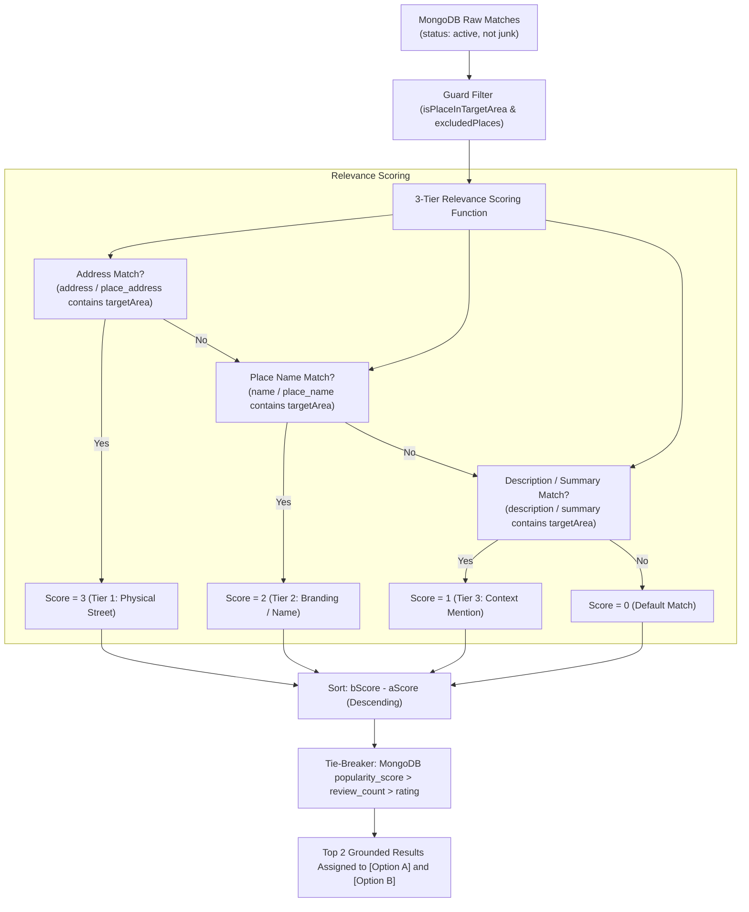

# Kia Kia Penang - Bird Backend: Area Conflict Exemptions & Priority Scoring Guide

> **Document Version**: 1.0  
> **Target Module**: `places-loader/services/birdPersonaEngine.js`  
> **Key Topics**: Area Conflict Guard, Hierarchy & Sub-district Exemptions, 3-Tier Priority Scoring Pipeline

---

## 1. Overview & Architecture Motivation

When users interact with Bird AI (e.g. asking for *"food in Gurney"*, *"cafes in Pulau Tikus"*, or *"things to do in Ayer Itam"*), the system resolves a **Target Area** to ground recommendations in real Penang geographic coordinates.

### 1.1 The Sub-District Dilemma (Why Naive Exclusion Fails)
In Penang's administrative and OpenStreetMap / Google Places dataset:
- Many world-famous precincts (such as **Gurney**, **Pulau Tikus**, **Jelutong**, **Gelugor**) physically reside inside the greater **George Town** municipality.
- In MongoDB (`places_new`), iconic spots like **Gurney Plaza**, **Gurney Drive Hawker Center**, and **Orinea Restaurant** often carry `area: "George Town"`.
- If the backend treats all other area names as strictly mutually exclusive `conflictingAreas`, querying for `Gurney` would mark `George Town` as conflicting. As a result, `{ area: { $nin: ['George Town', ...] } }` **discards 100% of authentic Gurney places**, inadvertently causing the AI to fall back to unrelated areas (such as Balik Pulau).

To solve this, the engine uses **Area Conflict Exemptions** (`AREA_CONFLICT_EXEMPTIONS`) paired with a **3-Tier Priority Scoring Algorithm** in `execQuery`.

---

## 2. Area Conflict Exemptions Matrix (`AREA_CONFLICT_EXEMPTIONS`)

Whenever a specific `targetArea` is targeted, all standard Penang districts form the initial candidate conflict pool:
```text
Base Conflict Pool:
['Air Itam', 'Ayer Itam', 'Bayan Lepas', 'Batu Ferringhi', 'George Town', 
 'Teluk Bahang', 'Tanjung Bungah', 'Tanjung Tokong', 'Pulau Tikus', 
 'Balik Pulau', 'Butterworth', 'Bukit Mertajam', 'Seberang Perai']
```

The system computes the active conflicting areas dynamically:
$$\text{ConflictingAreas} = \text{BaseConflictPool} \setminus (\{\text{TargetArea}\} \cup \text{Exemptions}(\text{TargetArea}))$$

### 2.1 Complete Exemption Mapping Table

| Target Area (`norm`) | Exempted Areas (`AREA_CONFLICT_EXEMPTIONS`) | Why Exempted? (Geographic & Data Reality) | Strictly Excluded Conflicts |
| :--- | :--- | :--- | :--- |
| **`gurney`** | `['George Town', 'Pulau Tikus']` | **Gurney Drive** is a coastal promenade along the George Town & Pulau Tikus municipal boundary. Most Gurney places have `area: "George Town"` in the database. | *Balik Pulau, Bayan Lepas, Batu Ferringhi, Teluk Bahang, Air Itam, Butterworth, Bukit Mertajam, Seberang Perai* |
| **`pulau tikus`** | `['George Town', 'Gurney']` | **Pulau Tikus** (postcode 10350) is an inner suburb directly adjacent to Gurney and part of George Town. Places frequently list `George Town` as city. | *Balik Pulau, Bayan Lepas, Batu Ferringhi, Teluk Bahang, Butterworth, Bukit Mertajam, Seberang Perai* |
| **`air itam`** | `['Ayer Itam', 'Penang Hill']` | **Air Itam** and **Ayer Itam** are spelling variations of the exact same town. Penang Hill (Bukit Bendera) base station is located in Air Itam. | *Balik Pulau, Bayan Lepas, Batu Ferringhi, George Town, Tanjung Bungah, Mainland* |
| **`ayer itam`** | `['Air Itam', 'Penang Hill']` | Mirror exemption for the alternate spelling. | *Same as Air Itam* |
| **`bayan lepas`** | `['Bayan Baru', 'Batu Maung']` | **Bayan Baru** is a township inside Bayan Lepas; **Batu Maung** is the southern tip adjacent to the airport. | *George Town, Air Itam, Batu Ferringhi, Balik Pulau, Tanjung Bungah, Mainland* |
| **`bayan baru`** | `['Bayan Lepas', 'Batu Maung']` | Sub-district of Bayan Lepas sharing postcodes 11950 / 11900. | *Same as Bayan Lepas* |
| **`tanjung tokong`** | `['Tanjung Bungah', 'Pulau Tikus']` | Coastal strip linking George Town to Tanjung Bungah (e.g. Straits Quay). | *Balik Pulau, Bayan Lepas, Air Itam, Butterworth, Bukit Mertajam* |
| **`tanjung bungah`** | `['Tanjung Tokong', 'Batu Ferringhi']` | North coast corridor connecting Tanjung Tokong to Batu Ferringhi. | *Balik Pulau, Bayan Lepas, Air Itam, George Town inner city, Mainland* |
| **`george town`** | `['Gurney', 'Pulau Tikus', 'Jelutong', 'Gelugor']` | Greater municipal hub covering inner suburbs; spots labeled as Gurney or Pulau Tikus belong to the wider George Town metro. | *Balik Pulau, Bayan Lepas, Batu Ferringhi, Teluk Bahang, Mainland* |
| **`balik pulau`** | `[]` *(None)* | Balik Pulau is a self-contained rural district on the western side of Penang Island; no urban sub-district leakage allowed. | *All outer districts (George Town, Bayan Lepas, Air Itam, Batu Ferringhi, Mainland)* |
| **`batu ferringhi`**| `[]` *(None)* | Beach resort enclave in the north; distinct boundary. | *Balik Pulau, Bayan Lepas, Air Itam, George Town, Mainland* |
| **`teluk bahang`**  | `[]` *(None)* | Northwest eco-park haven (ESCAPE, Entopia, National Park); distinct boundary. | *All other districts* |

---

## 3. How the Priority Scoring in `execQuery` Works

Once MongoDB retrieves candidate records matching the query filter, `execQuery` evaluates and sorts the records so the most accurate geographic matches appear at the very top (Index 0 and 1) for [Option A] and [Option B].



### 3.1 The 3-Tier Match Scoring System

For each place $P$ and target area $A$ (e.g. `Gurney`):

$$\text{Score}(P) = \max\Big(\text{Score}_{\text{addr}}(P),\, \text{Score}_{\text{name}}(P),\, \text{Score}_{\text{desc}}(P)\Big)$$

| Priority Tier | Score Value | Evaluated Fields | Match Criteria & Rationale | Example Match for `Gurney` |
| :---: | :---: | :--- | :--- | :--- |
| **Tier 1 (Highest)** | **3** | `address`<br/>`place_address` | The place physically resides on a street or building explicitly bearing the target area name. | `68-18-1, Sunrise Gurney, Gurney Dr, 10250 George Town` (*Orinea Restaurant*) |
| **Tier 2 (Medium)** | **2** | `name`<br/>`place_name` | The venue name directly incorporates the area name. | `Gurney Plaza`, `Gurney Drive Hawker Center` |
| **Tier 3 (Lowest)** | **1** | `description`<br/>`summary`<br/>`place_summary` | The venue's description highlights proximity or features related to the area. | *Tree Bar* (`"Open-air bar located at the entrance of Gurney Plaza..."`) |
| **Default** | **0** | *(None)* | Matched via category or broader query without explicit area substring. | General spot in George Town without "Gurney" text |

### 3.2 JavaScript Implementation in `execQuery`

```javascript
// Located in services/birdPersonaEngine.js inside searchPlacesWithPostcodeAndAreaFallback()
let fresh = matches.filter(p => {
    const pName = p.name || p.place_name || '';
    const inTargetArea = !area || area === 'Penang' || isPlaceInTargetArea(p, area);
    return !JUNK_NAMES_REGEX.test(pName) && !isPlaceExcluded(pName, excludedPlaces) && inTargetArea;
});

// 🎯 Priority Sorting: address (3) -> name (2) -> description (1)
if (area && area !== 'Penang') {
    const aRegex = new RegExp(area.replace(/[.*+?^${}()|[\]\\]/g, '\\$&'), 'i');
    fresh.sort((a, b) => {
        const aAddr = aRegex.test(a.address || a.place_address || '') ? 3 : 0;
        const aName = aRegex.test(a.name || a.place_name || '') ? 2 : 0;
        const aDesc = aRegex.test(a.description || a.summary || a.place_summary || '') ? 1 : 0;
        const aScore = Math.max(aAddr, aName, aDesc);

        const bAddr = aRegex.test(b.address || b.place_address || '') ? 3 : 0;
        const bName = aRegex.test(b.name || b.place_name || '') ? 2 : 0;
        const bDesc = aRegex.test(b.description || b.summary || b.place_summary || '') ? 1 : 0;
        const bScore = Math.max(bAddr, bName, bDesc);

        return bScore - aScore;
    });
}
```

### 3.3 Tie-Breaking Hierarchy
When two candidates achieve the same priority score (e.g. both have Score = 3 because both addresses contain "Gurney Dr"):
1. **Pre-sort order from MongoDB** is preserved:
   ```javascript
   .sort({ popularity_score: -1, review_count: -1, rating: -1 })
   ```
2. Higher-rated and more reputable establishments naturally rank above lesser-known spots.
3. Places already added to the user's draft plan (`isPlaceInDraftPlan`) or mentioned in previous turns (`isPlaceExcluded`) are pre-filtered out, guaranteeing fresh suggestions every turn.

---

## 4. End-to-End Execution Trace Example

### Scenario: User says `"I want suggestion for food and dining"`
*Context*: Previous turn established interest in **Gurney**.

1. **Intent & Keyword Pipeline**:
   - `intent`: `RECOMMENDATION_REQUEST`
   - `targetArea`: `Gurney`
   - `reconcileAreaAndPostcode`: Resolves `targetPostcode = '10250'` from `AREA_POSTCODES['Gurney']`.
2. **`buildAreaQuery('Gurney')`**:
   - `exemptions`: `{'gurney', 'george town', 'pulau tikus'}`.
   - `conflictingAreas`: Excludes outer regions (Balik Pulau, Bayan Lepas, Batu Ferringhi, Mainland).
   - Searches `address`, `name`, and `description` for `"Gurney"`.
3. **Execution in MongoDB**:
   - Finds candidate records in Postcode 10250 with Food & Dining / Cafes categories.
4. **Scoring & Sorting**:
   - *Orinea Restaurant* (Address has `Gurney Dr`) $\rightarrow$ **Score 3**
   - *Gurney Drive Hawker Center* (Address has `Solok Gurney 1`, Name has `Gurney`) $\rightarrow$ **Score 3**
   - *Brown Pocket Cafe* (Address has `Persiaran Gurney`) $\rightarrow$ **Score 3**
   - *Tree Bar* (Description mentions `Gurney Plaza`) $\rightarrow$ **Score 1**
5. **Option Hydration**:
   - [Option A] $\rightarrow$ **Orinea Restaurant** (or Gurney Drive Hawker Center)
   - [Option B] $\rightarrow$ **Gurney Drive Hawker Center**
   - Guard `isPlaceInTargetArea(p, 'Gurney')` confirms `true`.
   - **Result**: Grounded Gurney spots delivered. **Zero leakage into Balik Pulau.**
